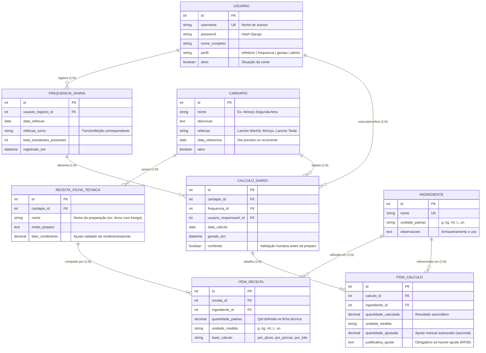

# AGENTS.md — Contexto do Sistema de Planejamento da Alimentação Escolar (SPAE)

> **Documento de Contexto Primário para Agentes de IA e Desenvolvedores**  
> Este documento consolida as diretrizes, regras de negócio, modelagem de dados, requisitos e padrões de engenharia para o desenvolvimento do **SPAE (Sistema de Planejamento da Alimentação Escolar)**.  
> Qualquer agente de IA atuando neste repositório **DEVE** seguir rigorosamente as regras, modelos e convenções aqui estabelecidas.

---

## 1. Visão Geral do Projeto

### 1.1 Identificação
- **Nome do Projeto:** Sistema de Planejamento da Alimentação Escolar (SPAE)
- **Tipo de Aplicação:** Aplicação Web Responsiva (Design Mobile-First com experiência tipo app)
- **Contexto de Origem:** Projeto Integrador / Extensão e Gestão Escolar (2026)
- **Público Beneficiado:** Profissionais do refeitório (merendeiras) e equipe de gestão escolar / secretaria de escola de tempo integral.
- **Stack Principal:** Python 3, Django, SQLite (dev) / PostgreSQL (prod), HTML5, CSS3, Bootstrap 5, JavaScript Vanilla.

### 1.2 O Problema
Atualmente, o refeitório escolar planeja as refeições e a dosagem de ingredientes por meio de **contagens e cálculos manuais diários**. Como o número de estudantes varia a cada dia e cada refeição possui um cardápio específico, o cálculo manual causa:
- Demora e sobrecarga cognitiva no início do turno de trabalho.
- Risco de erros de proporção, levando a sobra de comida (desperdício) ou falta de alimento.
- Retrabalho e dificuldade de planejamento prévio de estoque.

### 1.3 A Solução
Um sistema web intuitivo, acessível pelo celular no refeitório, que cruza a **Frequência Diária de Estudantes Presentes** com as **Fichas Técnicas / Cardápio do Dia**, calculando em segundos a lista exata de ingredientes e suas respectivas quantidades em unidades compreensíveis (kg, g, L, ml, unidades).

---

## 2. Personas e Perfis de Acesso (RBAC)

O sistema conta com 4 perfis de usuários com escopos bem delimitados:

| Perfil | Usuário Típico | Responsabilidades & Permissões |
|---|---|---|
| `refeitorio` | Merendeiras / Profissionais do Refeitório | Consultar o cálculo do dia, visualizar lista de ingredientes em tela otimizada para celular, marcar como conferido (`conferido=True`) e registrar eventuais ajustes com justificativa obrigatória. |
| `frequencia` | Secretaria / Equipe da Portaria | Informar diariamente a quantidade de estudantes presentes por data e refeição/turno. |
| `gestao` | Nutricionista / Direção Escolar | Cadastrar e aprovar cardápios, fichas técnicas de receitas, ingredientes, unidades e fatores de rendimento/perda. |
| `admin` | Administrador / Equipe de TI | Gestão geral de usuários, senhas, papéis, auditoria de logs e parametrizações técnicas. |

---

## 3. Regras de Negócio e Cálculos Críticos

### 3.1 Fórmula Fundamental do Cálculo
Para cada item da receita associado ao cardápio do dia:
$$\text{Qtd Calculada} = \text{Total Estudantes Presentes} \times \text{Quantidade Padrão por Aluno} \times \text{Fator de Rendimento}$$

- **Base de Cálculo (`base_calculo`):**
  - `por_aluno`: Multiplica diretamente pelo total de alunos presentes (ex: 80g de arroz cru / aluno $\times$ 120 alunos = 9,6 kg).
  - `por_porcao`: Caso a receita defina porção padrão consumida por aluno.
  - `por_lote`: Para receitas cuja base é calculada em bateladas/lotes (ex: 1 bolo para cada 30 alunos).
- **Fator de Rendimento / Perdas (`fator_rendimento`):**
  - Valor decimal padrão `1.000`. Usado caso haja fator de correção/perda validado (ex: contração ou descarte de cascas).

### 3.2 Conversão e Coerência de Unidades
- O sistema **NUNCA** deve converter automaticamente massa para volume (ex: kg para litros) sem fator de densidade explícito e homologado.
- Conversões permitidas dentro da mesma grandeza:
  - $1.000\text{ g} = 1\text{ kg}$ (exibir em kg quando $\ge 1.000\text{ g}$ para facilitar a leitura no refeitório).
  - $1.000\text{ ml} = 1\text{ L}$ (exibir em L quando $\ge 1.000\text{ ml}$).
  - `unidade` (un) permanece sempre inteira ou decimal simples.

### 3.3 Regras de Integridade e Validações
1. **Bloqueio de Cálculo sem Dados:** Não é permitido gerar cálculo se a frequência do dia/turno não foi informada ou se o cardápio não possui itens de receita cadastrados.
2. **Justificativa Obrigatória de Ajuste (RF09):** Caso a equipe do refeitório precise alterar a quantidade sugerida pelo sistema (`quantidade_ajustada`), o campo `justificativa_ajuste` torna-se de preenchimento **obrigatório**.
3. **Privacidade de Dados de Alunos:** O sistema manipula apenas o **número total de alunos presentes**. Não há cadastro nem armazenamento de nomes de estudantes para cálculo de merenda.
4. **Precisão Numérica:** Todas as quantidades, fatores e medidas numéricas **DEVEM** utilizar `DecimalField` no Django (nunca `FloatField`) para evitar discrepâncias de arredondamento em alimentos.

---

## 4. Arquitetura e Modelagem de Dados

### 4.1 Diagrama Entidade-Relacionamento (ERD)



### 4.2 Dicionário de Tabelas / Models

1. **`Usuario` (Custom User Model herdado de `AbstractUser`):**
   - Campos: `username`, `password`, `nome_completo`, `perfil` (`Choices: REFEITORIO, FREQUENCIA, GESTAO, ADMIN`), `ativo`.
2. **`Cardapio`:**
   - Representa o conjunto de preparações para um tipo de refeição (`refeicao`: "Lanche da Manhã", "Almoço", "Lanche da Tarde") e data de referência.
3. **`ReceitaFichaTecnica`:**
   - Preparação específica pertencente ao cardápio (ex: "Feijão Carioca", "Frango Ensopado").
   - Possui `fator_rendimento` (padrão `1.000`, 3 casas decimais).
4. **`Ingrediente`:**
   - Catálogo de insumos básicos (ex: Arroz Branco tipo 1, Feijão Carioca, Óleo de Soja, Sal).
5. **`ItemReceita`:**
   - Tabela associativa entre `ReceitaFichaTecnica` e `Ingrediente`.
   - `quantidade_padrao` (DecimalField, ex: max_digits=10, decimal_places=4).
   - `base_calculo` (`por_aluno`, `por_porcao`, `por_lote`).
6. **`FrequenciaDiaria`:**
   - Registro diário de presença por data e tipo de refeição.
   - Vinculado ao usuário que fez o lançamento.
7. **`CalculoDiario`:**
   - Registro principal de execução do cálculo para uma data e cardápio.
   - Flag `conferido` indicando que a profissional do refeitório revisou a lista.
8. **`ItemCalculo`:**
   - Detalhe de cada ingrediente computado.
   - Armazena `quantidade_calculada`, `quantidade_ajustada` e `justificativa_ajuste`.

---

## 5. Requisitos do Sistema

### 5.1 Requisitos Funcionais (RF)
- **RF01:** Autenticação de usuários por login e senha com perfis diferenciados.
- **RF02:** Cadastro, edição, inativação e consulta de cardápios e refeições.
- **RF03:** Cadastro e consulta de ingredientes, unidades de medida e dados de armazenamento.
- **RF04:** Associação de ingredientes e quantidades padrão às receitas/fichas técnicas.
- **RF05:** Seleção de data e cardápio correspondente para planejamento.
- **RF06:** Lançamento e consulta do total de estudantes presentes por data e turno/refeição.
- **RF07:** Cálculo automático da quantidade necessária de cada ingrediente a partir da frequência e ficha técnica.
- **RF08:** Apresentação do resultado em lista clara, destacando ingrediente, quantidade calculada e unidade de medida.
- **RF09:** Permissão de conferência e ajuste manual autorizado de quantidades com justificativa registrada.
- **RF10:** Histórico completo de frequências, cardápios utilizados e cálculos gerados.
- **RF11:** Capacidade de visualização para impressão ou exportação do resumo diário.

### 5.2 Requisitos Não Funcionais (RNF)
- **Usabilidade (Mobile-First):** Telas limpas, fontes legíveis (mínimo 16px para inputs e textos), botões grandes (touch targets de pelo menos 48x48px), evitando digitação desnecessária no celular.
- **Responsividade:** Layout adaptável de telas pequenas (smartphones a partir de 360px de largura) até desktops.
- **Segurança:** Autenticação padrão Django com senhas criptografadas (PBKDF2/Argon2); proteção CSRF ativa em todos os formulários; restrição de visualização baseada no perfil (`user_passes_test` ou decorators de grupo).
- **Confiabilidade:** Bloqueio de submissão com dados em branco ou inválidos; tratamento de exceções de divisão e conversão.
- **Performance:** Tempo de resposta rápido em consultas locais e de cálculo (inferior a 200ms em operações de cálculo).

---

## 6. Diretrizes de Interface e Experiência do Usuário (UI/UX)

1. **Contexto de Uso Real:**
   - As profissionais do refeitório utilizam o sistema frequentemente em pé, com mãos ocupadas ou avental, usando telas de smartphone.
   - A tela de **Resultado do Cálculo** deve ser legível à distância de um braço.
2. **Cores e Contraste:**
   - Cores com alto contraste (tema claro, verde/azul suave de alimentação escolar, estados visuais claros: verde para conferido, amarelo/laranja para pendente).
3. **Formulários:**
   - Teclados numéricos adequados em mobile (`<input type="number" inputmode="numeric">`).
   - Confirmação visual em ações destrutivas ou de recálculo.

---

## 7. Padrões de Código e Convenções para Agentes de IA

### 7.1 Estrutura Recomendada do Projeto Django

```text
projeto_integrador_merenda/
│
├── venv/                      # Ambiente virtual Python
├── manage.py                  # CLI do Django
├── config/                    # Configurações do projeto (settings, urls, wsgi)
│   ├── __init__.py
│   ├── settings.py
│   ├── urls.py
│   └── wsgi.py
│
├── apps/
│   ├── usuarios/              # Model Usuario customizado, auth, views de login
│   ├── cardapios/             # Cardapio, ReceitaFichaTecnica, Ingrediente, ItemReceita
│   ├── frequencia/            # FrequenciaDiaria, views de registro rápido
│   └── calculos/              # CalculoDiario, ItemCalculo, engine de cálculo e conferência
│
├── templates/                 # Templates HTML globais e por app (Bootstrap 5)
│   ├── base.html              # Layout mobile-first com navbar e bottom bar
│   ├── home.html
│   └── ...
├── static/                    # CSS customizado, JS, imagens/ícones
│   ├── css/style.css
│   └── js/main.js
├── tests/                     # Testes automatizados unitários e de integração
└── AGENTS.md                  # Este documento de referência
```

### 7.2 Regras de Codificação
- **Python / Django:**
  - Código limpo, seguindo PEP 8.
  - Utilizar `verbose_name` e `verbose_name_plural` em todos os models e fields (em português brasileiro).
  - Usar métodos `__str__` descritivos e amigáveis para cada modelo.
  - Implementar métodos de cálculo em camadas de serviço (`services.py`) ou métodos do Model, mantendo as views concisas.
  - Validações de integridade no método `clean()` dos models e nos `forms.ModelForm`.
- **Decimal vs Float:** NUNCA usar `models.FloatField()` para ingredientes, quantidades ou fatores. Usar sempre `models.DecimalField(max_digits=..., decimal_places=...)`.
- **Templates e Estilos:**
  - Usar tags semânticas do HTML5 e componentes responsivos do Bootstrap 5 via CDN ou arquivos locais.
  - Evitar CSS inline excessivo; centralizar classes no `style.css`.

---

## 8. Comandos de Ambiente e Execução

### 8.1 Ativação do Ambiente Virtual (Windows PowerShell)
```powershell
.\venv\Scripts\Activate.ps1
```

### 8.2 Inicialização e Migrações
```powershell
python manage.py makemigrations
python manage.py migrate
python manage.py createsuperuser
```

### 8.3 Execução do Servidor de Desenvolvimento
```powershell
python manage.py runserver
```

### 8.4 Testes Automatizados
```powershell
python manage.py test
```

---

## 9. Lista de Verificação de Implementação (Roadmap)

- [ ] **Etapa 1: Setup do Projeto e Autenticação**
  - [x] Configuração do projeto Django com settings em português (`pt-br`, `America/Sao_Paulo`).
  - [x] Implementação do modelo `Usuario` com perfis (`refeitorio`, `frequencia`, `gestao`, `admin`).
  - [ ] Tela de Login e controle de acesso por perfil.
- [ ] **Etapa 2: Módulo de Cardápios e Ingredientes**
  - [x] Model de Ingredientes com unidades padrão e admin (`g`, `kg`, `ml`, `L`, `un`).
  - [x] CRUD de Cardápios e Fichas Técnicas (`ReceitaFichaTecnica`, `ItemReceita`).
  - [x] Validação de quantidades e unidades.
- [ ] **Etapa 3: Módulo de Frequência Diária**
  - [ ] Formulário ágil mobile para lançamento de presença por data e turno/refeição.
  - [ ] Histórico de presenças.
- [ ] **Etapa 4: Motor de Cálculo e Conferência**
  - [ ] Implementação do algoritmo de cálculo proporcional.
  - [ ] Tela de visualização limpa do cálculo com lista de ingredientes (destaque visual).
  - [ ] Fluxo de conferência (`conferido=True`) e registro de ajuste justificado.
- [ ] **Etapa 5: Refinamento Mobile & Validação com Usuárias**
  - [ ] Ajuste de layout para dispositivos móveis (botões grandes, contrastes).
  - [ ] Seeds / Fixtures com receitas reais de merenda para testes e demonstração.
  - [ ] Testes de cálculos manuais vs automáticos.
