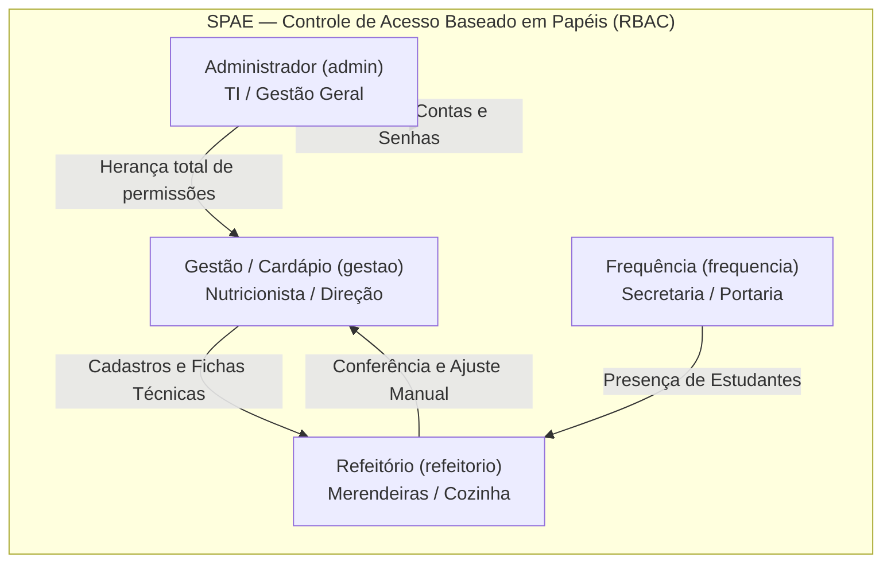

# Matriz de Perfis de Acesso e Permissões (RBAC) — SPAE

> **Sistema de Planejamento da Alimentação Escolar (SPAE)**  
> **Requisito Atendido:** RF01 — Autenticação de usuários por login e senha com perfis diferenciados.  
> **Padrão de Segurança:** Controle de Acesso Baseado em Papéis (*Role-Based Access Control* - RBAC) implementado em [merenda/permissions.py](file:///c:/Users/ALUNO/OneDrive/Documentos/projeto_integrador_merenda/merenda/permissions.py).

---

## 1. Visão Geral dos 4 Papéis do Sistema

O SPAE conta com 4 perfis bem delimitados para atender a divisão de tarefas da escola de tempo integral:



| Perfil | Identificador Técnico | Ator Principal | Escopo de Trabalho |
|---|---|---|---|
| **Refeitório** | `refeitorio` | Merendeiras / Cozinheiras | Consultar o cálculo do dia, visualizar lista de insumos com fontes grandes no celular, validar separação no estoque, marcar como conferido (`conferido=True`) e registrar eventuais ajustes com justificativa obrigatória (RF09). |
| **Frequência** | `frequencia` | Secretaria / Portaria | Informar diariamente a quantidade de estudantes presentes por data e turno/refeição. |
| **Gestão** | `gestao` | Nutricionista / Direção Escolar | Cadastrar e aprovar cardápios, fichas técnicas de receitas, catálogo de insumos, unidades homologadas e fatores de rendimento/perda. |
| **Administrador** | `admin` | Coordenação / TI Escolar | Gestão completa de usuários, papéis, redefinição de senhas, ativação/desativação de contas e auditoria geral. |

---

## 2. Matriz de Permissões por Módulo e Rota

Legenda:
- **✓ (Permitido):** Acesso liberado para o perfil.
- **✗ (Bloqueado):** Acesso negado com redirecionamento e mensagem explicativa de permissão insuficiente.
- **👁 (Leitura):** Permissão apenas de visualização / consulta.

| Módulo / Funcionalidade | Rota URL | Refeitório | Frequência | Gestão | Admin | Decorator Django |
|---|---|:---:|:---:|:---:|:---:|---|
| **Login / Logout** | `/login/`, `/logout/` | ✓ | ✓ | ✓ | ✓ | Público / `@login_required` |
| **Meu Perfil / Troca de Senha** | `/meu-perfil/`, `/alterar-senha/` | ✓ | ✓ | ✓ | ✓ | `@login_required` |
| **Ajuda e Documentação** | `/ajuda/` | ✓ | ✓ | ✓ | ✓ | `@login_required` |
| **Dashboard / Home** | `/` | ✓ | ✓ | ✓ | ✓ | `@login_required` |
| **Lançar Frequência** | `/frequencia/registrar/` | ✗ | **✓** | **✓** | **✓** | `@frequencia_requerida` |
| **Editar/Excluir Frequência** | `/frequencia/<id>/editar/`, `/excluir/` | ✗ | **✓** | **✓** | **✓** | `@frequencia_requerida` |
| **Consultar Lista de Frequência** | `/frequencia/` | 👁 | ✓ | ✓ | ✓ | `@login_required` |
| **Cadastrar Cardápio** | `/cadastros/cardapios/novo/` | ✗ | ✗ | **✓** | **✓** | `@gestao_requerida` |
| **Editar/Excluir Cardápio** | `/cadastros/cardapios/<id>/editar/` | ✗ | ✗ | **✓** | **✓** | `@gestao_requerida` |
| **Cadastrar Ficha / Receita** | `/cadastros/cardapios/<id>/receitas/nova/` | ✗ | ✗ | **✓** | **✓** | `@gestao_requerida` |
| **Cadastrar Ingrediente** | `/cadastros/ingredientes/novo/` | ✗ | ✗ | **✓** | **✓** | `@gestao_requerida` |
| **Editar/Excluir Ingrediente** | `/cadastros/ingredientes/<id>/editar/` | ✗ | ✗ | **✓** | **✓** | `@gestao_requerida` |
| **Consultar Hub de Cadastros** | `/cadastros/` | 👁 | 👁 | ✓ | ✓ | `@login_required` |
| **Visualizar Cálculo Diário** | `/calculo/`, `/calculo/<id>/` | **✓** | 👁 | ✓ | ✓ | `@login_required` |
| **Marcar como Conferido** | `/calculo/<id>/conferir/` | **✓** | ✗ | **✓** | **✓** | `@refeitorio_requerido` |
| **Ajustar Quantidade (RF09)** | `/calculo/itens/<id>/ajustar/` | **✓** | ✗ | **✓** | **✓** | `@refeitorio_requerido` |
| **Gerar Novo Cálculo** | `/calculo/gerar/` | **✓** | ✗ | **✓** | **✓** | `@refeitorio_requerido` |
| **Imprimir Ficha A4** | `/calculo/<id>/imprimir/` | **✓** | 👁 | ✓ | ✓ | `@login_required` |
| **Exportar Planilha (CSV)** | `/calculo/<id>/exportar-csv/` | **✓** | 👁 | ✓ | ✓ | `@login_required` |
| **Listar Usuários** | `/usuarios/` | ✗ | ✗ | ✗ | **✓** | `@admin_requerido` |
| **Criar Novo Usuário** | `/usuarios/novo/` | ✗ | ✗ | ✗ | **✓** | `@admin_requerido` |
| **Editar Perfil / Status** | `/usuarios/<id>/editar/` | ✗ | ✗ | ✗ | **✓** | `@admin_requerido` |
| **Redefinir Senha de Usuário** | `/usuarios/<id>/redefinir-senha/` | ✗ | ✗ | ✗ | **✓** | `@admin_requerido` |
| **Alternar Ativo/Inativo** | `/usuarios/<id>/alternar-status/` | ✗ | ✗ | ✗ | **✓** | `@admin_requerido` |

---

## 3. Implementação Técnica dos Decorators no Django

O controle de acesso é aplicado de forma declarativa sobre as views em [merenda/views.py](file:///c:/Users/ALUNO/OneDrive/Documentos/projeto_integrador_merenda/merenda/views.py), utilizando o módulo [merenda/permissions.py](file:///c:/Users/ALUNO/OneDrive/Documentos/projeto_integrador_merenda/merenda/permissions.py):

```python
# Exemplo de decorator genérico parametrizado:
def perfil_requerido(*perfis_permitidos, redirect_url='home'):
    def decorator(view_func):
        @wraps(view_func)
        def _wrapped_view(request, *args, **kwargs):
            if not request.user.is_authenticated:
                return redirect('login')
            if request.user.is_superuser or request.user.perfil in perfis_permitidos:
                return view_func(request, *args, **kwargs)
            
            messages.error(request, f"Acesso não autorizado para o perfil {request.user.get_perfil_display()}.")
            return redirect(redirect_url)
        return _wrapped_view
    return decorator
```

### Principais Decorators em Operação:
- `@refeitorio_requerido`: Libera o acesso para os perfis `refeitorio`, `gestao` e `admin`.
- `@frequencia_requerida`: Libera o acesso para `frequencia`, `gestao` e `admin`.
- `@gestao_requerida`: Libera o acesso para `gestao` e `admin`.
- `@admin_requerido`: Exclusivo para o perfil `admin` e superusuários.

---

## 4. Salvaguardas e Regras de Segurança

1. **Superusuário Transversal:** Contas marcadas com `is_superuser=True` possuem bypass autorizado para manutenções emergenciais.
2. **Proteção Contra Auto-bloqueio:** O administrador é bloqueado pelo sistema ao tentar desativar sua própria conta via interface (`usuario_alvo == request.user`).
3. **Contas Inativas:** Se um usuário for desativado (`ativo=False`), o sistema invalida a autenticação no login imediatamente com aviso de conta desativada.
4. **Proteção CSRF:** Todos os formulários possuem tokens criptográficos anti-falsificação (``).
